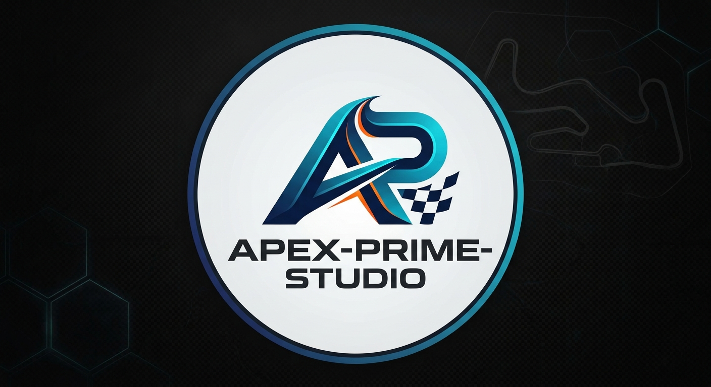

  

# 👋 Welcome to Apex Prime Studio

**Open-Source Racing Games, Vehicle Physics & Simulation Engineering**

We build high-performance, modular open-source racing games and engine components. Our focus is on bringing realistic vehicle dynamics, real-time telemetry analysis, and high-octane gameplay to the open-source community.

---

## 🛠️ Core Focus Areas

* 🏎️ **Vehicle Dynamics & Physics:** Real-time suspension modeling, tire friction curves, and drivetrain simulation.
* 📊 **Telemetry & Analytics:** Live data logging, lap timing, and vehicle diagnostic frameworks.
* 🌐 **Multiplayer & Netcode:** Real-time physics synchronization for competitive racing.
* 📄 **Open Research Software:** Archiving citable codebases with DOIs and technical software papers.

---

## ⚡ Featured Projects

| Project | Description | Tech Stack | Status |
| :--- | :--- | :--- | :--- |
| **Apex Racing Engine** | Modular vehicle physics & simulation framework | C++ / Physics | 🚧 In Active Dev |
| **Telemetry-Dash** | Real-time vehicle telemetry visualizer | Python / C# | 🛠️ Planning |

---

## 🧰 Tech Stack & Tools

* **Languages:** C++, C#, Python, Rust
* **Simulation & Math:** Rigid Body Dynamics, Linear Algebra, Telemetry APIs
* **Ecosystem:** GitHub, Zenodo, ORCID

---

## 🤝 Connect & Collaborate

* 🆔 **ORCID iD:** [0009-0005-6645-7964](https://orcid.org/0009-0005-6645-7964)
* 💼 **GitHub Handle:** `@Apex-Prime-Studio`
* 💬 Open to contributions, physics optimization discussions, and game engine collaborations!

---

<i>Driven by open source. Built for speed.</i>

